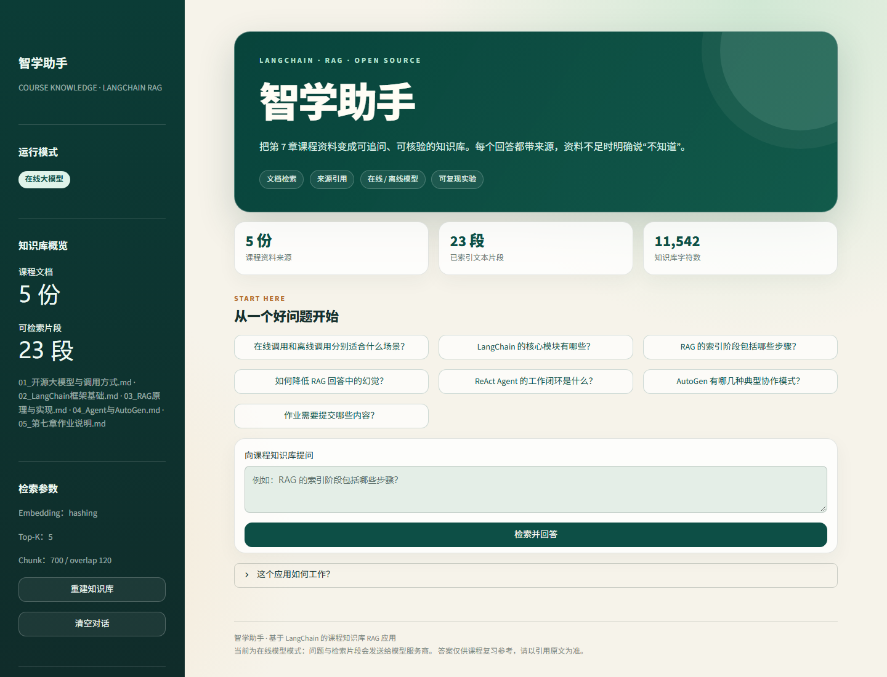
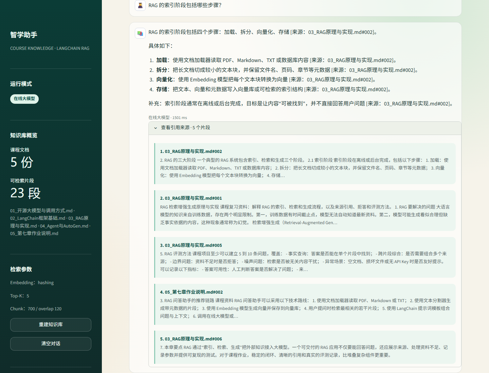
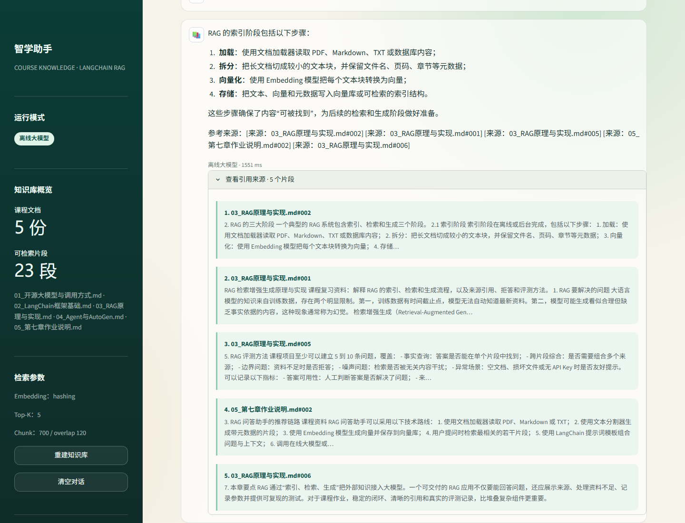
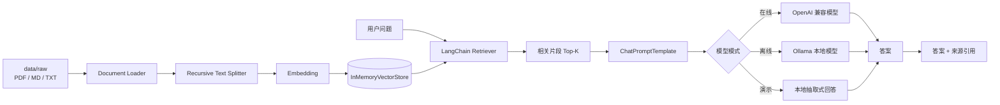

# 智学助手 · Course Knowledge RAG

> 基于 **LangChain** 的课程知识库问答应用：导入课程资料，检索相关片段，生成带来源的回答；资料不足时明确拒答。

**课程**：《开源软件构建技术》第七章 智能应用开发  
**作者**：张天健  
**开源仓库**：<https://github.com/dusk5-Surtr/course-rag-assistant>  
**运行方式**：本地演示 / 在线大模型 / Ollama 离线模型

---

## 1. 项目简介

课程资料往往分散在多个文件中，直接使用通用聊天模型复习时，容易出现三个问题：不知道资料在哪里、回答无法核验、模型会编造课件中没有的内容。

「智学助手」将课程资料整理为一个可检索的知识库：

1. 加载 `data/raw/` 中的 PDF、Markdown 或 TXT；
2. 切分为带文件名和稳定片段编号的文本块；
3. 使用 Embedding 将文本块写入 LangChain 向量库；
4. 用户提问时，通过 Retriever 召回相关片段；
5. 将问题和上下文交给大模型生成答案；
6. 在界面中展示引用来源；
7. 当资料不足时拒绝编造。

项目同时支持**在线大模型**、**Ollama 离线模型**和**无 Key 本地检索演示**三种模式，方便在不同网络、硬件和评审环境中运行。

### 核心亮点

- 真实使用 LangChain `Document`、`TextSplitter`、`Embeddings`、`InMemoryVectorStore`、`Retriever`、`ChatPromptTemplate`、`ChatModel` 和 `OutputParser`；
- 回答附带 `文件名#片段编号`，界面可以展开查看原文；
- 提示词要求“只依据资料回答”，无依据时明确说“未找到”；
- 章节标题感知的轻量混合重排，改善短标题问题的召回；
- 检索相关性门控与引用补全，降低小参数离线模型的离题和漏引用；
- 已实际验证 DeepSeek 在线模型与 Ollama 本地模型两条链路；
- 支持 DeepSeek/Qwen 等 OpenAI 兼容接口，也支持本地 Ollama；
- 无 API Key 时自动/手动切换到本地演示模式，不会白屏；
- 包含 8 条固定评测问题和可复现的评测脚本；
- 在线、离线模式通过 `.env` 切换，不修改源码；
- 示例资料可公开，仓库不包含真实密钥或个人隐私。

## 2. 界面预览

### 2.1 在线大模型模式





### 2.2 Ollama 离线模型模式



> 截图来自本项目真实运行结果。在线截图使用 DeepSeek `deepseek-chat`；离线截图使用 Ollama `qwen2.5:1.5b`。两种模式均能展示检索来源，资料不足时会明确拒答。

## 3. 功能清单

### 已实现

- [x] 加载 Markdown、TXT、PDF 文档；
- [x] 递归字符切分，并保存 `file_name`、`page`、`chunk_index`、`citation` 元数据；
- [x] 使用 LangChain `InMemoryVectorStore` 完成向量检索；
- [x] 章节标题感知的混合重排与检索相关度门控；
- [x] 使用 LangChain Prompt、ChatModel、OutputParser 组合问答链；
- [x] 支持在线 OpenAI 兼容接口与离线 Ollama；
- [x] 无 API Key 的本地检索演示模式；
- [x] 带来源的回答、引用补全与来源片段展开；
- [x] 对资料外问题拒答；
- [x] Streamlit 网页界面与示例问题；
- [x] 15 个自动化测试与 8 条固定问题评测；
- [x] GitHub Actions 自动运行测试与演示评测；
- [x] `.env` 密钥隔离与 `.gitignore`；
- [x] 公开示例课程资料。

### 暂未实现

- 扫描版 PDF 的 OCR；
- 多用户登录、权限控制与云端持久化；
- 多轮对话记忆；
- 向量索引磁盘缓存（当前启动时重建小型知识库）；
- 生产级神经 Reranker 与大规模检索基础设施。

## 4. 系统架构



### 数据流

**建库**

```text
文档 → 加载 → 切分 → Embedding → InMemoryVectorStore
```

**问答**

```text
问题 → Retriever Top-K → 拼接带来源标识的上下文
     → ChatPromptTemplate → ChatModel → OutputParser
     → 答案 + 引用片段
```

### 为什么保留演示模式

课程评审环境可能没有 API Key、无法访问外网或没有 GPU。演示模式保证应用仍能启动，并让评审检查检索、来源展示、拒答和异常处理。README 与界面都会明确标注它是“本地检索演示”，不会把它冒充为大模型输出。

## 5. 技术栈

| 层次 | 选型 | 说明 |
|---|---|---|
| 语言与环境 | Python 3.11+ | 本项目在 Python 3.11.4 下验证 |
| Web 界面 | Streamlit | 入口 `app.py` |
| 应用编排 | LangChain | 文档、检索器、提示词、模型、输出解析 |
| 向量存储 | `InMemoryVectorStore` | 适合小型课程知识库 |
| 默认 Embedding | Signed Hashing Embedding | 零下载、确定性、离线可运行 |
| 检索增强 | 标题感知混合重排 + 相关度门控 | 候选扩召回后按正文覆盖和章节标题重排 |
| 可选 Embedding | `BAAI/bge-small-zh-v1.5` | 通过 `langchain-huggingface` 接入 |
| 在线模型 | DeepSeek / Qwen 等 OpenAI 兼容接口 | 已实测 `deepseek-chat` |
| 离线模型 | Ollama | 已实测 `qwen2.5:1.5b` |
| PDF 解析 | pypdf | 仅支持有文本层的 PDF |
| 测试与评测 | pytest + 固定问题集 | 见 `tests/` 与 `scripts/evaluate.py` |

## 6. 快速开始

### 6.1 环境要求

- Python 3.11 或更高版本；
- Windows、Linux 或 macOS；
- 演示模式无需 GPU、无需 API Key；
- 离线模型模式需要安装 [Ollama](https://ollama.com/)；
- 在线模型模式需要模型平台的 API Key。

### 6.2 克隆与安装

```bash
git clone https://github.com/dusk5-Surtr/course-rag-assistant.git
cd course-rag-assistant
```

Windows PowerShell：

```powershell
python -m venv .venv
.\.venv\Scripts\Activate.ps1
python -m pip install -r requirements.txt
Copy-Item .env.example .env
```

Linux / macOS：

```bash
python -m venv .venv
source .venv/bin/activate
pip install -r requirements.txt
cp .env.example .env
```

### 6.3 无 Key 启动演示模式

`.env.example` 默认就是 `LLM_PROVIDER=demo`，直接启动即可：

```bash
streamlit run app.py
```

浏览器打开终端显示的地址，通常是 <http://localhost:8501>。可以点击页面中的示例问题，或输入：

> RAG 的索引阶段包括哪些步骤？

演示模式会使用本地检索找到相关片段，并用抽取式摘要展示答案和来源。它**不会调用外部大模型**。

### 6.4 切换在线大模型

以 DeepSeek 为例，编辑 `.env`：

```dotenv
LLM_PROVIDER=openai_compatible
LLM_MODEL=deepseek-chat
LLM_BASE_URL=https://api.deepseek.com
LLM_API_KEY=sk-你的密钥
```

重启应用：

```bash
streamlit run app.py
```

Qwen、其他兼容 OpenAI 接口的服务也可以使用同一套配置，只需替换模型名称、接口地址和 Key。具体模型名以平台文档为准。

### 6.5 切换离线 Ollama

1. 安装 Ollama；
2. 拉取一个本地模型。本仓库已验证 `qwen2.5:1.5b`：

```bash
ollama pull qwen2.5:1.5b
```

3. 修改 `.env`：

```dotenv
LLM_PROVIDER=ollama
LLM_MODEL=qwen2.5:1.5b
LLM_BASE_URL=http://127.0.0.1:11434
LLM_API_KEY=
```

4. 启动应用。

离线模式要求本机有足够的内存或显存；首次拉取模型需要联网。模型越大，效果通常越好，但硬件要求也越高。本机验证环境为 32 GB 内存、NVIDIA RTX 4060 Laptop 4 GB 显存，`qwen2.5:1.5b` 单次问答约 1.5～3.5 秒。

### 6.6 可选：使用本地语义 Embedding

默认的 Hashing Embedding 适合零下载运行，但语义能力有限。若想提升中文检索质量，可安装可选依赖：

```bash
pip install -r requirements-local-embedding.txt
```

然后在 `.env` 中修改：

```dotenv
EMBEDDING_PROVIDER=huggingface
EMBEDDING_MODEL=BAAI/bge-small-zh-v1.5
```

首次启动会下载模型权重。CPU 也可以运行小型中文 Embedding，但速度取决于硬件。

## 7. 使用说明

1. 启动应用；
2. 在侧边栏确认运行模式和知识库片段数；
3. 点击示例问题，或在输入框中提问；
4. 阅读答案；
5. 展开“查看引用来源”，核对文件与片段；
6. 尝试询问知识库外的问题，确认系统拒答；
7. 在侧边栏可重建知识库或清空对话。

### 示例问题

- 在线调用和离线调用分别适合什么场景？
- LangChain 的核心模块有哪些？
- RAG 的索引阶段包括哪些步骤？
- 如何降低 RAG 回答中的幻觉？
- ReAct Agent 的工作闭环是什么？
- AutoGen 有哪几种典型协作模式？
- 作业需要提交哪些内容？

### 知识库外问题示例

> MCP 协议是什么？

示例知识库没有覆盖 MCP。预期结果是明确说明资料不足，而不是编造协议内容。

## 8. 资料与配置

### 8.1 示例资料

`data/raw/` 中提供 5 份课程复习资料：

| 文件 | 内容 |
|---|---|
| `01_开源大模型与调用方式.md` | 开源模型属性、在线与离线调用、安全实践 |
| `02_LangChain框架基础.md` | 核心模块、LCEL、关键对象、常见问题 |
| `03_RAG原理与实现.md` | 索引、检索、生成、切分、幻觉与评测 |
| `04_Agent与AutoGen.md` | ReAct、工具、单/多智能体、协作模式 |
| `05_第七章作业说明.md` | 交付要求、README、仓库与提交检查 |

示例资料为课程复习目的的原创整理，用于演示知识库问答流程。

### 8.2 添加自己的资料

将文件放入 `data/raw/`，支持：

- `.md`
- `.txt`
- 有文本层的 `.pdf`

重新启动应用，或在侧边栏点击“重建知识库”。

### 8.3 主要环境变量

| 变量 | 默认值 | 说明 |
|---|---|---|
| `LLM_PROVIDER` | `demo` | `demo` / `openai_compatible` / `ollama` |
| `LLM_MODEL` | `deepseek-chat` | 模型名称 |
| `LLM_BASE_URL` | `https://api.deepseek.com` | OpenAI 兼容接口或 Ollama 地址 |
| `LLM_API_KEY` | 空 | 在线模式密钥，禁止提交 |
| `EMBEDDING_PROVIDER` | `hashing` | `hashing` / `huggingface` |
| `EMBEDDING_MODEL` | `BAAI/bge-small-zh-v1.5` | 使用 HuggingFace Embedding 时的模型名 |
| `TOP_K` | `5` | 检索片段数 |
| `CHUNK_SIZE` | `700` | 文本块字符数 |
| `CHUNK_OVERLAP` | `120` | 相邻块重叠字符数 |
| `DATA_DIR` | `data/raw` | 资料目录 |

## 9. 测试与评测

### 9.1 自动化测试

```bash
python -m pytest -q
```

测试覆盖：

- Hashing Embedding 的确定性与归一化；
- 示例资料加载、切分和 citation 元数据；
- 课程问题能够检索到对应来源；
- 标题感知重排能够找到 ReAct 章节；
- 演示模式生成带来源的回答；
- 知识库外问题能够被相关性门控拒绝；
- 缺失行内引用时自动补充来源；
- LangChain 问答链可以使用注入的测试模型运行；
- OpenAI 兼容接口与 Ollama 协议路径可以通过本地 Mock 服务完成调用；
- Streamlit 页面可以启动并完成一次示例问答。

### 9.2 固定问题集评测

在线模式（使用 `.env` 中的在线配置）：

```bash
python scripts/evaluate.py
```

离线模式（PowerShell 环境变量覆盖示例）：

```powershell
$env:LLM_PROVIDER="ollama"
$env:LLM_MODEL="qwen2.5:1.5b"
$env:LLM_BASE_URL="http://127.0.0.1:11434"
python scripts/evaluate.py --output evaluation/offline.md --json evaluation/offline.json
```

无模型演示模式：

```bash
python scripts/evaluate.py --demo
```

脚本会生成：

- `evaluation/latest.md` / `evaluation/latest.json`：默认评测结果；
- `evaluation/offline.md` / `evaluation/offline.json`：离线模型评测结果。

评测覆盖事实问答、跨片段信息、拒答和来源定位。

### 9.3 实际验证结果

验证时间：2026-11-14；环境：Windows + Python 3.11.4 + Ollama 0.40.16。

| 验证项 | 实际结果 |
|---|---|
| 自动化测试 | `15 passed` |
| 在线模型评测 | DeepSeek `deepseek-chat`：`8/8`，100% |
| 离线模型评测 | Ollama `qwen2.5:1.5b`：`8/8`，100% |
| 真实浏览器页面 | 在线首页、在线回答、离线回答均已截图并人工检查 |
| 在线调用链 | 真实 DeepSeek API 返回带行内来源的回答 |
| 离线调用链 | 真实 Ollama 本地模型完成问答；缺失行内引用时自动补全来源 |
| 协议兼容测试 | OpenAI 兼容接口与 Ollama `/api/chat` 的 Mock 测试仍保留 |
| 拒答能力 | 知识库外 MCP 问题由相关性门控明确拒绝 |
| API Key 泄露检查 | 仓库只包含 `.env.example`，无真实密钥 |

> 评测口径说明：8 条问题使用关键词覆盖和来源定位进行自动检查，不代表完整的人工语义评分。
> 在线报告见 [evaluation/latest.md](evaluation/latest.md)，离线报告见 [evaluation/offline.md](evaluation/offline.md)。

### 9.4 手工验收建议

1. 删除 `.venv` 后按 README 重新安装，验证可复现性；
2. 使用 `/` 路径和中文路径各启动一次；
3. 在没有 API Key 的情况下确认演示模式可用；
4. 配置自己的 Key 后确认在线模式可回答；
5. 启动 Ollama 后确认离线模式可回答；
6. 上传一个知识库外问题，确认出现明确拒答；
7. 检查浏览器与仓库中不含真实 Key。

## 10. 项目结构

```text
course-rag-assistant/
├─ app.py                         # Streamlit 应用入口
├─ src/
│  ├─ config.py                   # 环境变量与运行参数
│  ├─ embeddings.py               # Hashing / HuggingFace Embedding
│  ├─ ingest.py                   # 文档加载、切分和元数据
│  ├─ prompts.py                  # 系统提示词与 RAG 提示模板
│  ├─ providers.py                # 在线 / 离线模型工厂
│  ├─ rag.py                      # 检索、问答链、来源与演示回答
│  └─ text_utils.py               # 中文检索词项与句子切分
├─ data/raw/                      # 示例课程资料
├─ docs/images/                   # README 截图
├─ .github/workflows/tests.yml    # GitHub Actions 自动测试
├─ evaluation/                    # 实际评测报告
│  ├─ latest.md                   # 在线模型报告
│  ├─ latest.json
│  ├─ offline.md                  # Ollama 离线模型报告
│  ├─ offline.json
│  └─ github_verification.txt
├─ scripts/
│  ├─ evaluate.py                 # 固定问题集评测
│  ├─ capture_screenshots.py      # 真实浏览器截图
│  └─ export_readme_pdf.py        # README.pdf 导出
├─ tests/
│  ├─ test_app.py                 # Streamlit 界面冒烟测试
│  ├─ test_embeddings.py
│  ├─ test_ingest.py
│  ├─ test_provider_http.py       # 在线/离线协议集成测试
│  └─ test_rag.py
├─ .env.example
├─ .gitignore
├─ LICENSE
├─ pytest.ini                    # 测试路径与项目根目录
├─ README.md
├─ README.pdf                    # 作业平台可预览版
├─ SUBMISSION.md                 # 提交文案与检查清单
├─ requirements-dev.txt
├─ requirements-local-embedding.txt
└─ requirements.txt
```

## 11. 设计取舍

### 为什么默认使用 Hashing Embedding

课程作业首先需要**可复现**和**在任何机器上能启动**。默认 Hashing Embedding 具有以下优点：

- 不需要下载模型；
- 不需要网络；
- 结果是确定性的，便于自动测试；
- 在小型中文课程资料上可以完成词面检索。

它不是语义 Embedding，因此 README 不把它宣传成“大模型向量”。追求更好效果时，可以切换到 HuggingFace 的中文句向量模型。

### 为什么使用 InMemoryVectorStore

项目知识库只有 5 份示例资料，启动时重建向量库的成本很低。`InMemoryVectorStore` 减少外部数据库依赖，让评审可以直接运行。若知识库扩大，建议替换为 Chroma、FAISS 或 PostgreSQL + pgvector，并把索引持久化。

### 为什么增加标题感知重排

纯哈希向量在小型中文语料上存在两个问题：短标题的权重不足，以及“ReAct Agent 的工作闭环”这类问法容易被含有 “Agent/工作” 的无关段落抢走。实现会先扩大候选集，再综合正文词项覆盖、章节标题匹配和向量召回顺序做轻量重排，最后才交给模型。

### 为什么有演示模式

作业要求开发智能应用，但评审环境不一定有 API Key。演示模式解决的是“应用能否启动、检索和来源展示是否工作”的问题；真实大模型路径仍通过 `openai_compatible` 和 `ollama` 保留，并在 README 中明确区分。

## 12. 安全与隐私

- 真实 API Key 只放在 `.env`，`.env` 已被 `.gitignore`；
- 仓库只提交 `.env.example`；
- 不使用个人隐私或受限版权资料作为示例；
- 在线模式下，问题与检索片段会发送给模型服务商；
- 离线模式下，生成在本机完成；
- 演示模式不调用外部大模型；
- 模型输出不应被视为事实来源，正式使用应以引用原文为准；
- 不应把模型生成的代码直接执行。

## 13. 已知限制

- 演示模式是抽取式回答，不是大模型生成；
- Hashing Embedding 主要依赖词面特征，同义改写能力有限；
- 知识库每次启动重建，不适合大规模语料；
- 尚未实现 OCR、多轮记忆、权限控制和持久化；
- 在线模式依赖服务商网络和额度；
- 小参数离线模型在复杂推理上可能不稳定；本项目用相关性门控和引用补全降低风险，但仍不等同于大模型质量保证；
- 检索结果和模型回答仍需人工核验。

## 14. 后续可扩展方向

- 使用 Chroma/FAISS 持久化向量索引；
- 引入 BGE-M3/BM25 混合检索与神经 Reranker；
- 增加引用高亮与 PDF 页码跳转；
- 支持多轮对话和会话隔离；
- 加入 LangGraph 工作流与工具调用；
- 使用 LangSmith 或本地日志追踪评测；
- 增加 GitHub Actions 自动测试。

## 15. 许可证与致谢

本项目代码采用 [MIT License](LICENSE)。

感谢以下开源项目与生态：

- [LangChain](https://www.langchain.com/)：应用编排与检索组件；
- [Streamlit](https://streamlit.io/)：交互界面；
- [Hugging Face](https://huggingface.co/)：可选本地 Embedding 模型生态；
- [Ollama](https://ollama.com/)：本地模型运行方案；
- [pypdf](https://github.com/py-pdf/pypdf)：PDF 文本解析。

模型、依赖和第三方数据仍遵循各自的许可证与使用条款。

---

**课程作业**：第七章 智能应用开发  
**开源仓库**：<https://github.com/dusk5-Surtr/course-rag-assistant>  
**README 更新日期**：2026-11-14
